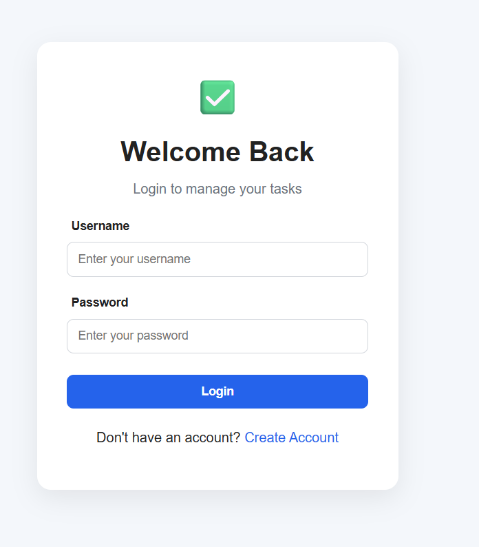
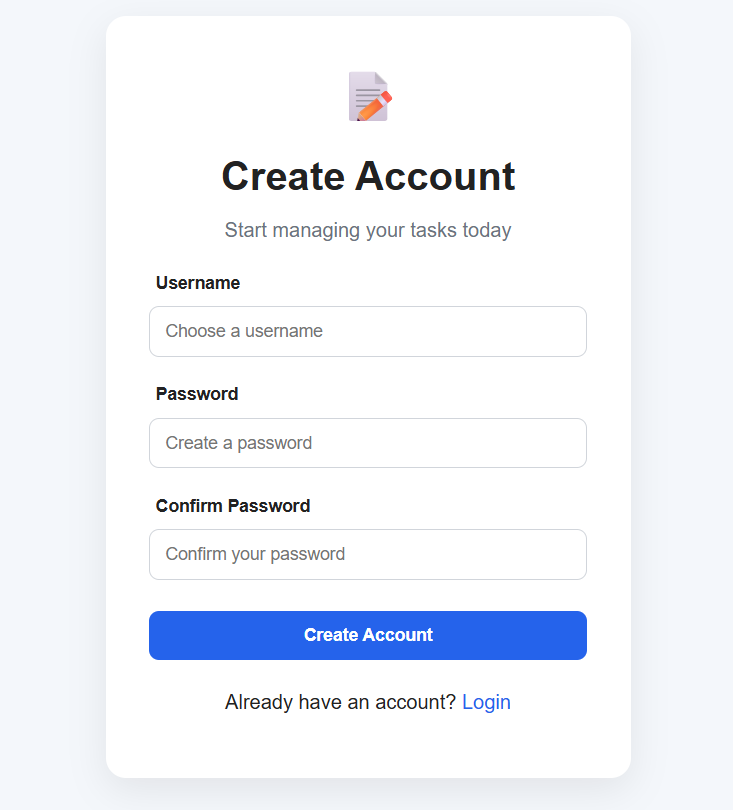
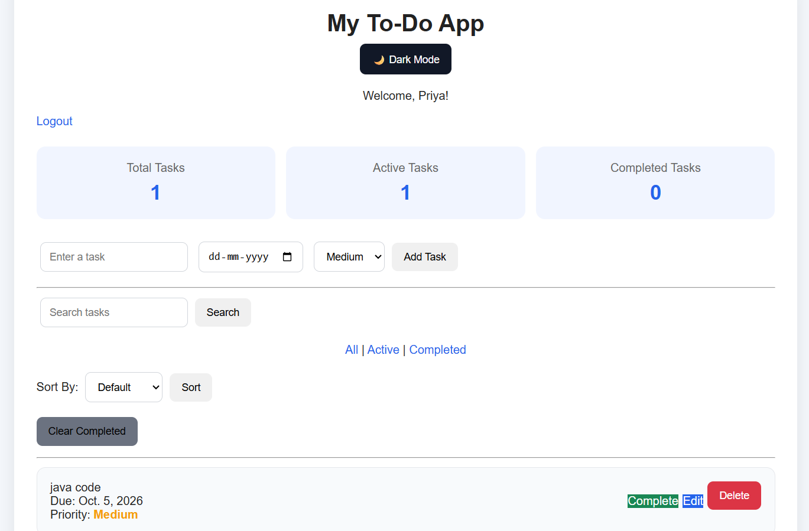
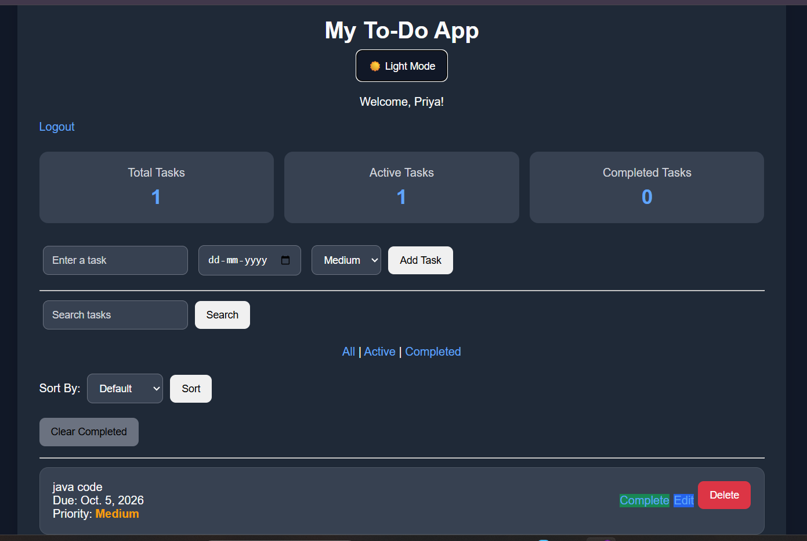

# Django To-Do Task Manager

A Django-based task management web application that allows users to securely manage their personal tasks with authentication, priorities, due dates, search, filtering, sorting, and task statistics.

## Features

* User Registration
* User Login and Logout
* User-specific task management
* Add new tasks
* Edit existing tasks
* Delete tasks
* Mark tasks as completed or active
* Set task priority
* Set due dates
* Search tasks
* Filter tasks by All, Active, and Completed
* Sort tasks by Priority and Due Date
* Task statistics dashboard
* Overdue task indication
* Clear all completed tasks
* Delete confirmation
* Empty-state message
* Responsive design
* Light and Dark theme
* Theme preference saved using browser localStorage

## Technologies Used

* Python
* Django
* SQLite
* HTML5
* CSS3
* JavaScript
* Git
* GitHub

## Project Structure

```text
django-todo-task-manager/
│
├── manage.py
├── .gitignore
├── README.md
│
├── todo/
│   ├── migrations/
│   ├── static/
│   │   └── todo/
│   │       └── style.css
│   │
│   ├── templates/
│   │   └── todo/
│   │       ├── home.html
│   │       ├── login.html
│   │       ├── register.html
│   │       └── edit.html
│   │
│   ├── admin.py
│   ├── apps.py
│   ├── models.py
│   ├── tests.py
│   └── views.py
│
└── todo_project/
    ├── settings.py
    ├── urls.py
    ├── asgi.py
    └── wsgi.py
```

## Installation and Setup

### 1. Clone the repository

```bash
git clone https://github.com/PSHANMUGAPRIYA08/django-todo-task-manager.git
```

### 2. Open the project

```bash
cd django-todo-task-manager
```

### 3. Create a virtual environment

```bash
python -m venv venv
```

### 4. Activate the virtual environment

For Windows:

```bash
venv\Scripts\activate
```

### 5. Install Django

```bash
pip install django
```

### 6. Apply migrations

```bash
python manage.py migrate
```

### 7. Start the development server

```bash
python manage.py runserver
```

Open the application in your browser at:

```text
http://127.0.0.1:8000/
```
## Screenshots

### Login



### Register



### Dashboard - Light Mode



### Dashboard - Dark Mode




## Application Flow

```text
Register
   ↓
Login
   ↓
Task Dashboard
   ↓
Add / Edit / Complete / Delete Tasks
   ↓
Search / Filter / Sort
   ↓
View Task Statistics
```

## Authentication

The application uses Django's built-in authentication system to manage users.

Each user can access and manage only their own tasks.

## Task Management

Each task contains:

* Task title
* Due date
* Priority
* Completion status
* User association

The application also identifies overdue tasks based on their due date and completion status.

## Theme

The application provides:

* Light Mode
* Dark Mode

The selected theme is stored in browser `localStorage`, so the preference remains after refreshing the page.

## Future Improvements

Possible future improvements include:

* Task categories
* Pagination
* Password reset
* Email notifications
* User profile management
* REST API integration
* Deployment to a cloud platform

## Author

**Shanmugapriya P.**

B.E. Computer Science and Engineering
